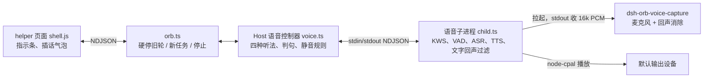

# 悬浮球语音「执行与播报期间接着听」实现方案

> 对照 [07-voice-listen.md](07-voice-listen.md)。交互以那份需求为准。本文只写改哪里、按什么顺序改、每一步怎么验收。
> 本文建立在已经合入的 [06-voice-plan.md](06-voice-plan.md) 之上。06 里没被本文提到的部分一律不动。
> 做完一节再做下一节。每一节的验收没过，不要开始下一节。第 1–8 节不需要麦克风，用脚本子进程和单测就能走通；第 9–11 节才碰真设备。
>
> **2026-10-21 修订：插话改为「硬停旧轮 + 另起新任务」。** 命中插话时不再使用官方 `steer`，而是 `sessionController.cancel` 旧轮，等官方 `turn/end` 后把原话作为 `mode: 'queue'` 的新消息发送。0.1 节保留为官方的历史行为参考；第 1 节第 2 条、4.4、4.5、4.6、4.7、5、13、14、15 已按修订更新。
>
> **2026-10-23 修订：VPIO 采集默认下线。** macOS 上 VPIO 会压低整个系统输出，且 macOS 26.4 无法通过公开属性或私有 unduck 关掉。生产改用 `node-cpal` 普通采集 + 基于 TTS PCM 的软件 AEC；`bodyBusy` 期间仍返回 `interject`，`echo.ts` 的文字回声过滤继续兜底。第 9、10 节的 VPIO 方案只作为历史/实验记录，见 [04-addenda.md](04-addenda.md) 第 28 节。

## 0. 已经定下来的做法

下面这些已经查证过，直接照做，不用再选型。

1. **听法从三种变成四种。** 在现有的 `off`、`wake`、`command` 之外，新增 `interject`：Agent 正在执行，或正文还在播时，转写开着，但只认退下口令和插话关键词。子进程把 `command` 和 `interject` 当成同一种「转写」处理，两者之间切换时 VAD 不重置、麦克风不断开。一句话怎么判，看的是**这句开口那一刻**的听法：子进程在 `utterance` 里带上开口时的 `mode`。用户正说着的时候，Host 不从转写切到唤醒，等这句说完再切（第 4.6 节）。这样收尾刚好在用户说到一半时播完，这句插话也不会丢，也不会被当成普通语音输入发出去。
2. **执行中插话改成硬停旧轮 + 新任务。** Host 画完用户气泡后直接调 `ctx.sessionController.cancel({ sessionId })`，等同点「停止」；官方在 aborted 驱动的 `finally` 里写 `turn/end`。Host 收到 `turn/end` 后再走 `submitPrompt()` 的新任务路径（`mode: 'queue'`），把原话作为下一条用户消息发送。不再调用 `mode: 'steer'`，也不再经过页面的 `voice-prompt`。只有收尾在播、执行已经结束时，直接按新任务发送，不需要 cancel。
3. **回声消除做在采集这一层。** 新增一个原生小程序 `dsh-orb-voice-capture`，由语音子进程拉起。它采集麦克风，消掉电脑自己放出的声音，再把 16kHz 单声道 PCM 交给子进程。macOS 用系统的 Voice Processing I/O（VPIO）。Windows 用 WASAPI 采集，把默认扬声器的回采（loopback）作为参考，交给 WebRTC AEC3 处理。**播报不动**，仍由子进程用 `node-cpal` 放到默认输出设备。
4. **再加一道文字回声过滤。** 子进程知道自己在什么时候播了哪句话。一句转写落地时，如果它和同一时段正在播的文字高度重合，就丢掉。这只是兜底，主力仍是第 3 条的回声消除。
5. **提问卡期间真正放开麦克风设备。** Host 每次推送听法时多带一个字段 `device`。提问卡在等时为 `false`，子进程关掉采集，系统的麦克风指示随之消失。提示语照常播，因为播报不走采集程序。
6. **停止、退下、插话之后，旧的正文不再补出声音。** Host 按 block key 处理：
   - 插话时，旧轮被取消。命中前已经写出的正文照常上屏，但一律不再出声；取消过程中才写完的那部分也不再出声。`muted` 一直保持到新任务 `beginTurn()`，下一步起写的正文才恢复播报。上屏不受任何影响。
   - 停止和退下时，被停的那一轮剩下的正文全部静音，直到下一轮开始。
   - 停止、退下和插话之后，到执行真正停下之前，听法为 `off`（第 3.2 节的 `stopping`）。插话要等旧轮 `turn/end` 之后才作为新任务发送；这段时间的听法关闭。
7. **TTS 后端仍不绑定模型。** 听法只读队列状态，也就是「正文在播」「本地短句在播」，不读 TTS 的模型种类。子进程的 `speak` / `stop-speak` 协议就是以后换后端的边界。本次不做后端选择。
8. **官方仓库一行不改。**

### 0.1 官方 `steer` 的行为（历史参考；修订后不再使用）

> 2026-10-21 修订后，插话不再使用 `steer`。下面保留是为了解释旧实现和官方行为；其中的 `cancel` 行为（保留收件箱、abort 信号）仍然适用。

| 情况 | 结果 | 出处（`deepseek-harness` 仓库） |
|---|---|---|
| 执行中发 `steer` | 不中断当前的模型输出和工具。这一步的工具全部做完后，下一步开头把这句作为 `user/message` 写入并发给模型。同一轮继续，没有新的 `turn/start` | `packages/core/agent-loop/src/agent.ts` 的 `steer()`、`send()`，以及第 361–366 行的收件箱检查；测试 `agent-loop/tests/loop.spec.ts` 「injects steering between steps and continues the turn」 |
| 发的时候正好是最后一步（模型在写收尾、没有工具） | 收件箱里还有 `steer`，会强制再走一步，同一轮继续 | 同上，第 361–366 行 |
| 空闲时发 `steer` | 立刻开新的一轮，效果等同 `queue` | `agent.ts` 的 `wakeDriver`；测试 `loop.spec.ts` 「starts idle steering synchronously」 |
| 刚好在本轮结束的瞬间送达 | 不丢。被转成紧接着的新一轮，Host 会收到 `turn/start` | `agent.ts` 第 392 行 `if (!this.inbox.hasPending) return false` |
| `cancel` 之后 | 官方用 `keepInbox: true`，没处理的 `steer` / `queue` 留在收件箱，等下一次发消息时一起带进去 | `api/session-controller/src/commands.ts` 的 `cancel()` |
| `cancel` 已发出、这一轮还没回到空闲时再发 `steer` | 被记下，这一轮结束后官方自动开新的一轮 | `agent.ts` 第 156–160、219–221、260–262 行 |
| `steer` 写进会话的 `user/message` | 和 `queue` 完全同形：`source.kind === 'user'`，没有区分字段 | `commands.ts` 第 334–338 行 |
| 支持的版本 | `dsh-v0.1.0-rc.7` 起就有，插件声明的 `>=0.1.7-rc.2 <0.3.0-0` 全部支持 | `git log -S steer` |

对插件的影响：

- 插话这句的用户气泡由 Host 自己画（`consume()` 实时跳过 `source.kind === 'user'` 的 `user/message`，和打字发送一样）。回放历史时，它会作为一条普通用户消息出现在那一轮中间。
- Host 以为还在执行、实际刚结束时发出的 `steer`，官方会自动开新的一轮。现有 `consume()` 里 `turn/start` 的分支会调用 `beginTurn()`，插件不需要补救。
- 停止或退下之后、执行真正停下之前，插件不再发 `steer`：Host 在这段时间把听法置为 `off`（第 3.2 节的 `stopping`）。否则「退下吧」之后紧跟的一句插话会让官方自己再开一轮。
- 第 15 节记下了 `cancel` 保留收件箱带来的一个已知行为。
- **修订后的实际流程：** 气泡仍由 Host 画；`cancel` 后等 `turn/end`；不等 `steer`，也不把插话塞回旧轮。`turn/end` 分支负责启动 pending 插话。

### 0.2 回声消除已有的实测（macOS 26.4，MacBook Air 内置麦克风和扬声器）

用一段含「大肥鱼……退下吧」的 13.6 秒中文 TTS 做远端声音，采集结果送进产品同款的 Silero VAD 和 SenseVoice：

| 采集方式 | 远端声音 | 识别结果 |
|---|---|---|
| 原始麦克风（现状） | 另一个进程播放 | 整段都被转写出来，包括「大肥鱼」「退下吧」 |
| VPIO | 另一个进程播放，第一次冷启动 | 前 7 秒漏出 1 句 |
| VPIO | 另一个进程播放，第二次 | 0 句 |
| VPIO | 从 VPIO 自己的输出口播放 | 0 句 |

结论：

- VPIO 能消掉**同一输出设备上任何进程**放出的声音，包括浏览器、音乐和我们自己的 TTS，所以 TTS 不必从 VPIO 自己的输出口播。
- 第一次冷启动漏了 1 句，所以 VPIO 有收敛期。实验里另一个进程在启动 1 秒后才开始放声音，收敛跟「有没有远端声音」有关，跟「启动了多久」关系不大。提问卡每次都会让采集程序冷启动，所以第 9.3 节第 8 条专门验收冷启动，并写明了没过时怎么办。
- 以上只在 macOS 26.4 上测过。构建目标是 macOS 13 起，第 9.3 节第 9 条要求在 macOS 13、14 上重跑。

Windows 侧目前只有文档依据，第 10 节第一步就是可行性验证。

## 1. 改动总览



| 路径 | 改什么 |
|---|---|
| `packages/voice/src/settings.ts` | 新增 `interjectKeyword` |
| `packages/voice/src/dismiss.ts` | 包含匹配泛化，插话关键词复用 |
| `packages/voice/src/listen.ts` | 第四种听法 `interject`；设备是否占用 |
| `packages/voice/src/queue.ts` | 导出 `bodyBusy`、`localBusy` |
| `packages/voice/src/echo.ts`（新） | 文字回声过滤，纯函数 |
| `packages/voice/src/capture.ts`（新） | 采集源：原生采集程序 / `node-cpal` 兜底 |
| `packages/voice/src/child.ts` | 转写不断流、设备收放、接采集源、回声过滤 |
| `packages/voice/native/macos-voice-capture.swift`（新） | macOS 采集程序 |
| `packages/voice/native/windows-voice-capture.cpp`（新） | Windows 采集程序 |
| `packages/voice/scripts/build-macos-voice-capture.mjs`（新） | 编 macOS 通用二进制 |
| `packages/voice/scripts/build-windows-voice-capture.sh`（新） | 在 MSYS2 UCRT64 里编 Windows 可执行文件 |
| `packages/voice/prebuilds/darwin-universal/`、`win32-x64/`（新，入库） | 两个平台的预编译产物 |
| `packages/host/src/voice.ts` | 判句、插话、退下、静音规则、设备字段 |
| `packages/host/src/orb.ts` | `onInterject`（cancel 旧轮 + `turn/end` 后新任务）、pending 插话、`stopTurn` 回调、停止按钮静音 |
| `packages/helper/src/main.ts` | 转发 `voice-mode: 'interject'` |
| `packages/helper/assets/shell.js` | 指示条在执行中也显示；执行结束时按指针位置收回显示框 |
| `packages/client-settings/client.js` | 「插话关键词」一项 |
| `packages/bundle/scripts/assemble.mjs` | 把采集程序装进 `dist/voice/prebuilds` |
| `THIRD-PARTY-NOTICES.md` | WebRTC AudioProcessing、abseil 的许可 |

Host 与子进程之间的消息变化：

| 方向 | 消息 | 变化 |
|---|---|---|
| Host → 子进程 | `{ type: 'listen', mode, seedMs, device }` | `mode` 多一个 `'interject'`；新增 `device: boolean`，`false` 时子进程关掉采集 |
| 子进程 → Host | `{ type: 'mic', open, aec }` | 新增 `aec: boolean`，表示这次采集带不带回声消除 |
| 子进程 → Host | `{ type: 'utterance', text, mode }` | 新增 `mode`：这句开口那一刻的听法（`'command'` 或 `'interject'`）。被回声过滤丢掉的句子不发，只照常发 `speech: false` |
| Host → 页面 | `{ type: 'voice-mode', mode }` | `mode` 多一个 `'interject'` |

## 2. 设置：插话关键词

### 2.1 `settings.ts`

```ts
export interface VoiceSettings {
  // ...现有字段不动
  /** 执行和正文播报期间，整句带出这个词就算插话。空字符串表示执行和播报期间不听。 */
  interjectKeyword: string
}

export const DEFAULT_VOICE_SETTINGS: VoiceSettings = {
  // ...
  interjectKeyword: '大肥鱼',
}

// parseVoiceSettings 里：
interjectKeyword: text(item.interjectKeyword, DEFAULT_VOICE_SETTINGS.interjectKeyword, PHRASE_CHARS),
```

- `text()` 会去掉首尾空白，所以「只填空白」会存成 `''`，等于留空。字段缺失时取出厂值。
- 唤醒词和插话关键词是两项，改一个不动另一个。
- 路由和 `ProfileStore` 都走 `parseVoiceSettings`，不用另改。

### 2.2 设置页 `client-settings/client.js`

1. `VOICE_DEFAULTS` 加 `interjectKeyword: '大肥鱼'`。`normalizeVoice` 加一行：`typeof item.interjectKeyword === 'string' ? item.interjectKeyword : VOICE_DEFAULTS.interjectKeyword`。
2. 中英文案：`interjectKeyword: '插话关键词'` / `'Interjection keyword'`。
3. 在「语音输入」组的开关下面、退下口令上面加一行：`textRow(text.interjectKeyword, 'interjectKeyword', commandLocks)`。
4. 锁沿用 `commandLocks`：官方 ASR 不在时不能改，点击弹「要启动 ASR 语音模型」。语音输入开关关着时这一项仍能改，只是不生效（需求第 6 节）。

### 2.3 验收

- `packages/voice/tests/settings.test.ts`：缺字段时取「大肥鱼」；`'  '` 存成 `''`；超过 40 字截断；非字符串回到出厂值。
- `packages/client-settings/tests/section.test.mjs`：ASR 不在时这一行带 `is-locked`，点击弹出 ASR 的说明；ASR 在时能改，失焦后 POST `/.dsh-orb/voice` 的 body 里带 `interjectKeyword`。
- `packages/host/tests/routes.test.ts`：保存后 `GET /settings` 的 `voice.interjectKeyword` 是新值，重启 `ProfileStore` 后还在。

## 3. 听法：四种状态

### 3.1 `queue.ts` 加两个只读判断

```ts
/** Agent 正文正在播，或收尾还在队列里。途中句、未归类句、收尾都算；提问提示语、本地短句不算。 */
export function bodyBusy(state: QueueState): boolean {
  if (state.closing !== null) return true
  const kind = state.playing?.kind
  return kind === 'unclassified' || kind === 'mid' || kind === 'closing'
}

/** 唤醒回复语或退下回复语正在播。 */
export function localBusy(state: QueueState): boolean {
  return state.playing?.kind === 'local'
}
```

`playbackBusy` 和 `voiceHold` 保持原样。空闲计时 `idle.ts` 仍然用 `playbackBusy`。

「一句交给后端之后，到它说完或被停掉之前都算在播」（需求第 10 节）：队列在发出 `play` 时就把 `playing` 置上，直到收到 `playback-ended` 才清掉，现状已经满足，不用改。

### 3.2 `listen.ts`

```ts
export type ListenMode = 'off' | 'wake' | 'command' | 'interject'

/** command 和 interject 都是「转写开着」。 */
export function transcribing(mode: ListenMode): boolean {
  return mode === 'command' || mode === 'interject'
}

export interface ListenInput {
  readonly pinned: boolean
  readonly agentBusy: boolean
  readonly questionOpen: boolean
  /** queue.bodyBusy */
  readonly bodyBusy: boolean
  /** queue.localBusy */
  readonly localBusy: boolean
  /** 停止或退下已经发出、执行还没真正停下 */
  readonly stopping: boolean
  /** 唤醒开关开着、唤醒词不空、模型齐全 */
  readonly wakeEnabled: boolean
  /** 语音输入开关开着、官方 ASR 齐全 */
  readonly commandEnabled: boolean
  /** commandEnabled 并且插话关键词不是空的 */
  readonly interjectEnabled: boolean
  /** 子进程这次的采集带回声消除 */
  readonly echoCancel: boolean
  readonly micOpen: boolean
}

export function listenMode(input: ListenInput): ListenMode {
  if (input.questionOpen || input.localBusy || input.stopping || !input.micOpen) return 'off'
  if (input.agentBusy || input.bodyBusy) {
    if (!input.interjectEnabled) return 'off'
    // 没有 VPIO 也继续听；自己的播报由 echo.ts 的文字回声过滤丢掉。
    return 'interject'
  }
  if (!input.pinned && input.wakeEnabled) return 'wake'
  if (input.pinned && input.commandEnabled) return 'command'
  return 'off'
}

export interface DeviceInput extends MicInput {
  readonly pinned: boolean
  readonly agentBusy: boolean
  readonly questionOpen: boolean
  readonly bodyBusy: boolean
  readonly interjectEnabled: boolean
  readonly echoCancel: boolean
}

/** 子进程要不要占着麦克风设备。提问卡在等时一律放开。 */
export function holdsDevice(input: DeviceInput): boolean {
  if (input.questionOpen) return false
  const wakeReady = input.wakeEnabled && hasWakeWord(input.wakeWords) && input.wakeModel
  const commandReady = input.commandEnabled && input.asrModel
  if (!wakeReady && !commandReady) return false
  if (input.agentBusy || input.bodyBusy) {
    if (!commandReady || !input.interjectEnabled) return false
    return true
  }
  // 收起时只有唤醒可达，固定时只有语音输入可达。
  return input.pinned ? commandReady : wakeReady
}
```

`device` 不再只看“哪一列开着”，而是看**当前固定状态下哪一列真的可达**：

- 只开唤醒、把球固定：`wake` 不可达，`device` 为假，麦克风释放。
- 只开语音输入、把球收起：`command` 不可达，`device` 为假，麦克风释放。
- 执行中、播报中不看固定状态：插话列能跑就占麦。
- 回复、停止这类短暂的 `off` 不单独处理：当前固定状态下还有能恢复的列就保持，没有就释放，避免反复开关设备。

各行和需求的对应：

- 第 1 节表格第三行不看 `pinned`：执行中单击球取消固定后，仍然是 `interject`。
- 插话关键词留空、语音输入关掉或 ASR 不在时，`interjectEnabled` 为假，执行和播报期间回到 `off`，设备按上面的可达规则释放。
- 唤醒回复语和退下回复语在播时为 `off`（需求第 1 节、第 5 节）。
- 提问卡在等时为 `off`，并且 `holdsDevice` 为假（需求第 4 节）。
- 停止或退下之后、执行真正停下之前为 `off`（0.1 节最后一行）。这段时间通常不到 1 秒；当前固定状态下有可达列时设备保持，没有则释放。
- 没有回声消除时（采集程序缺失、启动失败，或这台机器上 VPIO 不可用），正文播报期间为 `off`。这偏离了需求第 1 节，是有意的降级：没有回声消除时，自己的播报会被转写成「用户的话」，违反需求第 11 节。第 15 节记下了这一条。

### 3.3 验收

把 `packages/voice/tests/listen.test.ts` 的表改成四种状态，至少覆盖：

| 输入 | 期望 |
|---|---|
| 没固定、空闲 | `wake` |
| 固定、空闲 | `command` |
| 执行中（固定或不固定都一样） | `interject` |
| 空闲，收尾在播，或收尾还在队列里 | `interject` |
| 执行中，插话关键词为空 | `off` |
| 执行中，语音输入关掉 | `off` |
| 空闲，收尾在播，`echoCancel: false` | `interject` |
| 执行中，没有播报，`echoCancel: false` | `interject` |
| 只开唤醒、固定 | `off`，`holdsDevice` 为假 |
| 只开语音输入、收起 | `off`，`holdsDevice` 为假 |
| 提问卡在等（不论其他） | `off`，`holdsDevice` 为假 |
| 「我在」或「好的，再见」在播 | `off` |
| 执行中，`stopping: true` | `off`，`holdsDevice` 按当前固定状态的可达列 |
| 麦克风没开 | `off` |

`queue.test.ts` 补上：途中句、未归类句、收尾在播或排队时 `bodyBusy` 为真；本地短句在播时 `localBusy` 为真、`bodyBusy` 为假；提问提示语在播时两者都为假。

## 4. 判句：一句落地之后（Host `voice.ts`）

### 4.1 包含匹配

`dismiss.ts` 把现有逻辑抽成通用函数，`isDismiss` 改为调用它：

```ts
/** 整句完整带出任意一条，就命中。空白、标点、全半角、拉丁大小写都忽略。 */
export function containsAny(text: string, phrases: readonly string[]): boolean { /* 现有 isDismiss 的实现 */ }
export function isDismiss(text: string, phrases: readonly string[]): boolean { return containsAny(text, phrases) }
export function isInterject(text: string, keyword: string): boolean { return containsAny(text, [keyword]) }
```

测试：「大肥鱼，你给我把明天的也查一下」「大 肥 鱼。」命中；「肥鱼把明天的也查一下」「大肥」不命中；关键词为 `''` 时不命中。

### 4.2 `onUtterance` 按开口时的听法分开处理

子进程的 `utterance` 带 `mode`（第 8.1 节）。Host 按这个 `mode` 判，不按落地那一刻的 `this.mode` 判。原因是从开口到落地至少隔 0.5 秒静音加一次识别，这期间收尾可能刚好播完、执行可能刚好结束，听法已经变了：

- 球没固定时变成 `wake`：用 `this.mode` 判会把这句插话丢掉，违反需求第 7 节最后一段。
- 球固定着时变成 `command`：用 `this.mode` 判会把「等一下」这种句子当普通语音输入发出去，违反需求第 2 节「都没有的句子丢掉」。

```ts
private onUtterance(text: string, tagged: unknown): void {
  const mode: ListenMode = tagged === 'command' || tagged === 'interject' ? tagged : this.mode
  this.speechOpen = false
  if (!transcribing(mode) || !this.canFinish(mode)) return this.poll()
  const settings = this.options.settings()
  if (mode === 'command') {
    const spoken = stripWakePrefix(text, settings.wakeWords)
    if (!spoken) return this.poll()
    if (isDismiss(spoken, settings.dismissPhrases)) return this.dismiss()
    this.options.send({ type: 'voice-prompt', text: spoken })    // 有没有插话关键词都一样，原样上屏
    this.activity()
    return this.poll()
  }
  // interject：用原话判，不去唤醒词前缀。否则「你好大肥鱼，……」会被剥掉关键词
  const spoken = text.trim()
  if (isDismiss(spoken, settings.dismissPhrases)) return this.dismiss()   // 同时带关键词也只退下
  if (isInterject(spoken, settings.interjectKeyword)) return this.interject(spoken)
  this.poll()                                      // 其余丢掉：不上屏、不发送、不进输入框
}

/** 开口之后出现了「硬性关掉」的情况，这句就不要了。只是执行结束、正文播完这种变化不算。 */
private canFinish(mode: 'command' | 'interject'): boolean {
  if (this.questionOpen || this.stopping || localBusy(this.queue) || !this.micOpen) return false
  return mode === 'command' ? this.commandEnabled() : this.interjectEnabled()
}
```

- `commandEnabled()` 和 `interjectEnabled()` 是从 `pushListen()` 里抽出来的两个私有方法，算法见第 4.6 节，`pushListen()` 和这里共用。
- 现有的 `if (settings.commandEnabled && isDismiss(...))` 里那个 `commandEnabled` 判断可以去掉：`canFinish` 已经查过。
- 子进程是旧版、`utterance` 里没有 `mode` 时，退回按 `this.mode` 判。

### 4.3 退下

两种转写状态共用一个函数，顺序对应需求第 5 节：

```ts
private dismiss(): void {
  // 1. 还在执行：停掉这场执行，和点「停止」相同。这一轮剩下的正文一律静音，执行真正停下之前不听
  if (this.agentBusy) {
    this.muted = true
    this.stopping = true
    this.options.stopTurn?.()
  }
  // 2. 停正在播的正文，清空队列
  this.apply({ type: 'stop' })
  // 5. 回复语先排上，再取消固定。这样只推一次听法，中间不会闪出 wake
  const reply = this.localReply(this.options.settings().dismissReply)
  if (reply) this.apply({ type: 'local', text: reply })
  // 4. 取消固定。不主动收回显示框，收不收由页面按指针位置决定（06 第 6.1 节）
  this.requestUnpin()
  this.poll()
}
```

- 第 3 步「不进输入框、不上屏、不发给 Agent」：`dismiss()` 不发 `voice-prompt`，也不调 `interject`，自然满足。
- 回复语在播时 `localBusy` 为真，听法是 `off`。播完时如果执行已经停掉，就回到 `wake`。
- 执行中单击球取消过固定的情况：`requestUnpin()` 发现已经没有固定，什么都不做，显示框等执行结束后收回（第 7.2 节第 4 条补上了这条收回）。

### 4.4 插话

```ts
private interject(text: string): void {
  // 旧轮马上取消；重新进入转写时不要把旧任务的播报尾巴 seed 进来
  this.commandSeed = 0
  if (this.agentBusy) {
    this.muted = true       // 旧轮剩余正文不再出声，直到新任务 beginTurn()
    this.stopping = true    // 取消期间听法 off
  }
  // 旧步里迟到的正文也只上屏、不出声（兜底）
  for (const key of this.seen.keys()) this.silencedSteps.add(stepOf(key))
  this.apply({ type: 'stop' })           // 正在播的立刻停，排着的清掉
  this.options.interject?.(text)         // orb 取消旧轮，等 turn/end 后另起一轮
  this.poll()
}

/** cancel 失败时由 orb 调用：旧轮继续跑，恢复它的播报和听法。 */
resumeAfterInterjectFailure(): void {
  this.muted = false
  this.stopping = false
  this.commandSeed = 300
  this.silencedSteps.clear()
  if (!this.live) return
  this.pushListen(false)
  this.poll()
}
```

为什么现在不需要按「步」解释 steer：命中即 `cancel` 旧轮，旧轮不会再继续写下一步。`muted` 覆盖到新任务开始，保证取消期间迟到的正文也不出声；`silencedSteps` 是 key 级别的兜底。新任务由 orb 在 `turn/end` 后 `beginTurn()`，`muted` 此时清掉，新正文正常播。

正文块的 key 是 `b:${turn}:${step}:${index}`（`orb.ts` 的 `onChunk`）。`stepOf` 仍把同一步的块归到一起；新任务的 turn/step 不同，不受旧 `silencedSteps` 影响。

### 4.5 静音规则

`VoiceController` 增加三个字段：

```ts
/** 停止或退下之后，被停的那一轮剩下的正文都不播，直到下一轮开始。 */
private muted = false
/** 停止或退下已经发出、执行还没真正停下。这段时间不听。 */
private stopping = false
/** 插话那一刻正在进行的步（`b:${turn}:${step}`）。这些步里的正文只上屏，不出声。 */
private readonly silencedSteps = new Set<string>()
```

- `noteAssistant(key, text)`：照旧更新 `seen`。然后如果 `this.muted || this.silencedSteps.has(stepOf(key))`，就直接返回，不进队列。其余照旧。上屏走的是 `orb.ts` 的 `block()`，不经过这里，所以不受影响。
- `beginTurn()`：`muted = false`，`stopping = false`。新任务开始时恢复播报和听法。
- `endTurn()`：`stopping = false`。旧轮结束时不清 `muted`，要等下一次 `beginTurn()`。
- `interject()`：`commandSeed = 0`；`agentBusy` 时 `muted = true`、`stopping = true`，再 `apply({type:'stop'})`。取消期间旧正文不再出声，听法为 `off`。
- `resumeAfterInterjectFailure()`：`muted = false`、`stopping = false`、`commandSeed = 300`、`silencedSteps.clear()`，再 `pushListen(false)` + `poll()`；旧轮继续跑，恢复播报和听法。
- `haltSpeech()`（停止按钮）：**在 `if (!this.live) return` 之前**做 `if (this.agentBusy) { this.muted = true; this.stopping = true }`，然后照旧。子进程正在重启时也要记下静音，否则重启后会把被停那一轮剩下的正文播出来。这样也修掉停止按钮的一个隐患：`stopTurn()` 里的 `drain()` 可能带回最后一段已经定稿的正文，它会在 `endTurn` 时被拼成收尾播出来。
- `clearSession()`：`muted = false`，`stopping = false`，`silencedSteps.clear()`，和 `seen.clear()` 一起做。

### 4.6 其余要跟着改的地方

- 抽出两个私有方法，`pushListen()` 和 `canFinish()` 共用：
  - `commandEnabled()`：`settings.commandEnabled && presence.asr`（就是现在 `pushListen` 里那一行）。
  - `interjectEnabled()`：`commandEnabled() && normalizeUtterance(settings.interjectKeyword) !== ''`。用 `normalizeUtterance` 而不是 `trim()`：只填了标点的关键词永远匹配不上，不能因为它让执行期间一直开着转写。
- `pushListen()`：
  - 新的输入从 `queueView(...).playbackBusy` 改成 `bodyBusy(this.queue)`、`localBusy(this.queue)`，再加上 `stopping: this.stopping`。
  - `echoCancel` 取子进程最近一次 `mic` 消息里的 `aec`，存在新字段 `private echoCancel = false`。还没收到时按 `false` 算。`onChildExit`、`fresh`、`close` 时都要把它置回 `false`，否则换成 `node-cpal` 兜底的新子进程会沿用上一个的 `true`。
  - **用户正说着时不离开转写。** 算出新的 `mode` 以后，如果 `transcribing(this.mode) && !transcribing(mode) && this.speechOpen && this.canFinish(this.mode)`，就保持 `this.mode` 不变，直接返回。`canFinish` 为假（提问卡、回复语在播、停止中、麦克风关了、设置关掉了）时照常立刻切。子进程发 `speech: false` 时 Host 会再推一次听法（见下面的 `onChild`），那时再切。子进程在离开转写时会 `vad.reset()`，不这样等，用户说了一半的这句就没了。
  - 「进入转写」改成 `transcribing(mode) && !transcribing(this.mode)`：只有这时才带 `seedMs`。`command` 和 `interject` 之间切换不带种子，也不重置。
  - 「离开转写」改成 `transcribing(this.mode) && !transcribing(mode)`：这时把 `speechOpen` 置假。
  - 现有的 `if (mode !== 'command') send voice-level 0` 改成 `if (!transcribing(mode))`。
  - 计算 `device = holdsDevice({...})`。`mode` 或 `device` 任一变化都要发 `listen`。新增字段 `private device = false` 记住上次发的值。
  - `device` 从 `false` 变成 `true` 的那一次，`seedMs` 一律为 `0`。环形缓冲里是提问卡之前的旧声音，不能拼到卡片之后的第一句前面（子进程也会在关设备时清空环形缓冲，见第 8.2 节，两边都做）。
  - 硬插话后重新进入转写时 `seedMs` 也是 `0`：`interject()` 把 `commandSeed` 置 0，环形缓冲里是旧任务/播报的尾巴，不能 seed 进新任务的第一句。
- `onChild`：
  - `speech` 消息：`this.speechOpen = open && transcribing(this.mode)`。`open` 为假时调用 `this.pushListen(false)`，让第 4.6 节等着的切换发生。
  - `utterance` 消息：`this.onUtterance(message.text, message.mode)`。
  - `level` 消息：`transcribing(this.mode)` 时才转发给页面。
  - `mic` 消息：记下 `aec`，再推一次听法。
- `VoiceControllerOptions` 新增两项，都是**可选**的。这样现有测试里的 `new VoiceController({...})` 不用改也能编译：

```ts
/** 插话原话。orb 会硬停旧轮，再把这句话当作新任务发送。 */
interject?(text: string): void
/** 和点「停止」相同的执行停止。没有在执行时不做事。 */
stopTurn?(): void
```

### 4.7 验收

**先改脚本子进程和现有用例，否则新用例过不了：**

- `packages/host/tests/fixtures/voice-child.mjs` 第 33 行现在只发 `{ type: 'mic', open: true }`。改成读环境变量 `VOICE_AEC`（缺省 `'1'`）：`{ type: 'mic', open: true, aec: process.env.VOICE_AEC !== '0' }`。不改的话 `echoCancel` 一直是假，正文播报期间听法是 `off`，下面第 3、4、6、7 步都会失败。测试里启动脚本的地方（`voice.test.ts` 第 57 行的 `env`）按需传 `VOICE_AEC`。
- 现有用例里「执行中听法是 `off`」的断言改成 `interject`：`voice.test.ts` 第 92、116、122 行附近（`beginTurn()` 之后的 `assert.equal(voice.listenMode(), 'off')`）。提问卡那条（`questionOpened()` 之后是 `off`）不变。
- 「只在 `command` 时转发电平」的用例（第 234 行）改成「只在转写开着时转发」，并补一条 `interject` 时也转发。
- 「离开 command 时关掉说话边沿」的用例（第 210 行）按第 4.6 节的新规则改：用户正说着时，取消固定不会立刻离开转写；`speech: false` 之后才切到 `wake`，空闲计时随之恢复。

然后在 `packages/host/tests/voice.test.ts` 新写一个用例，按需求第 7 节走一遍。脚本子进程发的 `utterance` 带上 `mode` 字段，模拟开口时的听法：

1. `wake` → 播「我在」→ 播完后最后一次 `listen` 是 `command`，并且 `device: true`。
2. `utterance: 查一下今天的天气`（`mode: command`）→ 页面收到 `voice-prompt`。`beginTurn()` 后最后一次 `listen` 是 `interject`，没有新的 `seedMs > 0`，页面收到 `voice-mode: interject`。
3. `noteAssistant('b:1:0:0', '我去查一下今天的天气。')` → 发出 `speak`。此时 `utterance: 等一下`（`mode: interject`）→ 页面没有新的 `voice-prompt`，`interject` 回调没被调用。
4. `noteAssistant('b:1:0:0', '我去查一下今天的天气。明天')`，然后 `utterance: 大肥鱼，把明天的也查一下`（`mode: interject`）→ `interject` 回调收到原话（关键词还在）；子进程收到 `stop-speak`；`listen` 变成 `off`（`stopping`）。再 `noteAssistant('b:1:0:0', '我去查一下今天的天气。明天会下雨。后天晴。')` 和同一步的新块 `noteAssistant('b:1:0:2', '我先查一下。')`：都不产生新的 `speak`。然后 `endTurn()`（模拟 orb 取消旧轮收尾）→ `beginTurn()`（模拟 orb 在 `turn/end` 后起新任务）；新 step 的 `noteAssistant('b:2:0:0', '明天多云。')` 产生 `speak`。
5. `questionOpened()` → `listen` 为 `off` 且 `device: false`。`questionClosed()`，执行仍在 → 回到 `interject`，`device: true`。
6. `utterance: 大肥鱼退下吧`（`mode: interject`）→ `stopTurn` 被调用一次，`interject` 没被调用；页面收到 `unpin`；子进程先收到 `stop-speak`，再收到 `speak: 好的，再见`；回复在播时 `listen` 是 `off`。回复播完、`endTurn()` 之前，`listen` 仍是 `off`（`stopping`）。`endTurn()` 之后是 `wake`。
7. 另起一轮：`endTurn()` 后收尾在播（`bodyBusy`），听法是 `interject`。`utterance: 大肥鱼，再查一次`（`mode: interject`）→ 子进程收到 `stop-speak`，`interject` 回调收到原话（第 5 节的 orb 会直接作为新任务发送，不再走页面 `voice-prompt`）。
8. **收尾在用户说到一半时播完。** 球没固定，收尾在播，听法是 `interject`。子进程发 `speech: true`，然后让收尾播完（`playback end`）：`listen` 仍是 `interject`，没有发出 `wake`。子进程发 `speech: false`：`listen` 变成 `wake`。随后到达的 `utterance: 大肥鱼，再查一次`（`mode: interject`）仍然调用 `interject` 回调。把球改成固定、重复一遍，落地的 `utterance: 等一下`（`mode: interject`）不产生 `voice-prompt`。
9. 把 `interjectKeyword` 设成 `''`（再试一次 `'，。'`）后 `applySettings()`，执行中的听法变成 `off`。
10. 用 `VOICE_AEC=0` 启动脚本子进程：收尾在播时听法是 `off`，执行中没有播报时是 `interject`。
11. 停止按钮：执行中 `haltSpeech()` 后，听法是 `off`；再 `noteAssistant` 一个新 key 也不产生 `speak`。`endTurn()` 不产生收尾，听法恢复。下一次 `beginTurn()` 之后正文恢复播报。子进程已经退出、还没重启时调用 `haltSpeech()`，重启后再 `noteAssistant` 也不产生 `speak`。
12. 提问卡关掉、执行仍在：恢复 `device: true` 的那一次 `listen` 带 `seedMs: 0`。

## 5. 插话发出去（`orb.ts`）

### 5.1 接上控制器

在构造 `VoiceController` 的地方加：

```ts
interject: (text) => { void this.onInterject(text) },
stopTurn: () => { if (this.turnRunning) this.run('stop', () => this.stopTurn()) },
```

### 5.2 `onInterject`

```ts
private pendingInterject?: { text: string; key: string; sessionId?: string }

private async onInterject(text: string): Promise<void> {
  const trimmed = text.trim()
  if (!trimmed) return
  const key = `user:${randomUUID()}`
  this.block(key, 'user', trimmed, false, 'set')
  this.voice.activity()

  if (!this.turnRunning || this.sessionId === undefined) {
    await this.submitPrompt(trimmed)   // 只有收尾在播：直接另起一轮
    return
  }

  // 最新一句覆盖上一句尚未发送的插话
  if (this.pendingInterject) this.dropBlock(this.pendingInterject.key)
  const pending = { text: trimmed, key, sessionId: this.sessionId }
  this.pendingInterject = pending
  try {
    await this.ctx.sessionController.cancel({ sessionId: pending.sessionId })
    this.drain()
  } catch (error) {
    if (this.pendingInterject !== pending) return
    this.pendingInterject = undefined
    this.dropBlock(key)
    this.voice.resumeAfterInterjectFailure()
    this.status(errorMessage(error))
  }
}
```

- 用户气泡先画，cancel 失败再 `dropBlock`；成功就保留。
- 不调 `stopTurn()`：它会在 cancel 后立刻 `finishTurn()`，旧轮迟到的 `turn/end` 可能误停新轮。这里只 cancel，等真正的 `turn/end`。
- 不画第二次气泡：`submitPrompt()` 只发送，不画；`onPrompt()` 才画。
- `turn/end` 的 `consume` 分支：

  ```ts
  if (type === 'turn/end') {
    this.finishTurn()
    this.startPendingInterject()
  }
  ```

  `startPendingInterject()` 取 pending、核对 sessionId 后 `void this.submitPrompt(pending.text)`。
- 新任务由 Host 直接发送（`mode: 'queue'`），不广播 `voice-prompt`，因此不经过页面的 TCC 门、也不拼划词 chip；`submitPrompt()` 仍会 `foreground.restore()`、`ensureSession()`、`watch()`、`drain()`。
- 停止按钮、退下（`stopTurn()`）、手动打字（`onPrompt()`）、切换会话（`resetTranscript()`）都 `settlePendingInterject()`：清 pending、删气泡，避免旧插话在停止后突然发出。
- `cancel` 抛错时旧轮仍在跑：只显示状态、恢复 VoiceController 的播报/听法，不发新任务。
- 官方 `cancel` 保留收件箱；旧轮里排着的其他消息可能随新轮交付，见第 15 节。
- 不响应 `AbortSignal` 的工具会让官方等它 settle，`turn/end` 和 pending 新任务都会延后；这是官方边界，不伪造 finish。

### 5.3 验收

在 `packages/host/tests/runtime.test.ts` 的 harness 上加一个用例（`sessionController.prompt` 已经记录在 `calls.prompt`，需要把 `request.mode` 一起记下）：

测试运行时 `openVoiceChild()` 返回 `undefined`（`voice.ts` 里判断了 `NODE_TEST_CONTEXT`），走不到语音子进程，所以直接调用 `(orb as any).onInterject(text)`。

1. 打字发一句，让会话进入执行。送一句「大肥鱼，把明天的也查一下」。期望：`calls.cancel` 收到当前 session；页面先收到一个 `kind: 'user'` 的 block；`calls.prompt` 不增加（不再发 `steer`）；注入 `turn/end` 后，`calls.prompt` 新增一条 `mode: 'queue'`、文本是原话。
2. 本文轮结束后再送一句。期望：不调用 `cancel`，不广播 `voice-prompt`，直接新增一条 `mode: 'queue'`。
3. 让 harness 的 `cancel` 抛错后再送一句。期望：页面先收到 user block，然后收到它的删除；状态栏显示错误；`calls.prompt` 不增加。
4. 连续送两句：第一句的气泡被删除，`turn/end` 后只发送第二句。
5. 让 harness 的 `prompt` 抛错、在空闲时送一句。期望：用户气泡保留，状态栏显示错误，turn 结束。
6. 插话 pending 时点停止：pending 气泡删除，`turn/end` 后不发送新任务。

## 6. 提问卡：放开麦克风设备

Host 侧在第 4.6 节已经算好 `device`。子进程侧见第 8.2 节。这里只列验收：

- 脚本子进程：提问卡出现时 `listen` 带 `device: false`。点选、跳过、取消以后，按卡片消失那一刻的状态恢复（需求第 4 节的四条），并且 `device: true`。语音输入关着时，卡片消失后仍然是 `device` 按 `needsMicrophone` 算、听法不进入转写。
- 真机（第 11 节）：卡片出现后 1 秒内，macOS 菜单栏的麦克风指示消失，Windows 任务栏的麦克风图标消失。提示语照常播完；点选后如果还没播完，立刻停。

## 7. 页面

### 7.1 `helper/src/main.ts`

`voice-mode` 的白名单加上 `'interject'`：

```ts
if (mode === 'off' || mode === 'wake' || mode === 'command' || mode === 'interject') {
  win.webContents.send('orb:voice-mode', mode)
}
```

### 7.2 `helper/assets/shell.js`

1. `api.onVoiceMode`：`voiceMode = mode === 'command' || mode === 'interject' ? mode : 'off'`。从 `off` 进入这两种之一时，`voiceLevel = 0`。
2. `renderVoiceMeter`：去掉 `!running`。执行和播报期间只要转写开着，指示条就亮着（需求第 3 节末段）。

   ```js
   const listening = voiceMode === 'command' || voiceMode === 'interject'
   const active = listening && expanded && !asking()
   ```

   另外 `#voice-meter` 在 `#composer` 里面，而 `floating.css` 有 `body.running #composer { visibility: hidden }`，会把蓝条一起藏掉。必须在 `floating.css` 加：

   ```css
   body.running #voice-meter {
     visibility: visible;
   }
   ```

   子元素显式 `visible` 可以覆盖父级继承下来的 `hidden`；只改 `renderVoiceMeter` 的 `!running` 不够。

3. `api.onVoiceLevel`：条件从 `voiceMode === 'command'` 改成同样的 `listening`。
4. `setRunning(next)`：`next` 为假的分支末尾（`if (processGroup) {...}` 之后）加一行：

   ```js
   if (!pinned && !pointerInside) scheduleCollapse()
   ```

   原因：执行中退下时，Host 先发 `unpin`，`unpinFromHost()` 调的 `scheduleCollapse()` 因为 `running` 直接返回；退下回复语是本地短句，不会发 `voice-hold`，`applyVoiceHold` 里的收回也走不到。不加这一行，鼠标不在球上时显示框一直不收，违反需求第 5 节第 4 步。执行中单击球取消固定、TTS 关着的情况也是同一个问题，这次一起修掉。`scheduleCollapse()` 自己会检查提问卡、拖动和 `voiceHold`，收尾还在播时不会提前收。

执行途中插进一条用户消息后的过程计时不用改：`ensureProcess()` 新建过程组时已经有 `if (live) startProcessClock()`。

### 7.3 验收

`packages/helper/tests/shell-render.test.ts` 是对源码做正则断言，不跑 DOM，所以按现有写法补：

- 第 197 行的 `assert.match(code, /const active = voiceMode === 'command' && expanded && !running && !asking\(\)/)` 换成新表达式：`/const listening = voiceMode === 'command' \|\| voiceMode === 'interject'/` 和 `/const active = listening && expanded && !asking\(\)/`。
- 断言 `floating.css` 有 `body.running #voice-meter { visibility: visible; }`，否则执行期间蓝条仍被父级隐藏。
- 断言 `onVoiceMode` 接受 `'interject'`，`onVoiceLevel` 的条件用的是 `listening` 同一判断。
- 断言 `setRunning` 的结束分支里有 `if (!pinned && !pointerInside) scheduleCollapse()`。
- `packages/helper/tests` 里对 `main.ts` 白名单的断言（如果有）加上 `'interject'`。

行为上的验收放在第 12 节真机走查的第 3、5、6、8 步。

## 8. 语音子进程：转写不断流、设备收放、换采集源

### 8.1 四种听法

`child.ts` 的 `Engine.listen(mode, seedMs, device)`：

- `transcribing(previous) && !transcribing(mode)`：`vad.reset()`，电平发 0（就是现有的「离开 command」逻辑，换成 `transcribing` 判断）。
- `!transcribing(previous) && transcribing(mode)`：`meter.reset()`；`seedMs > 0` 时 `vad.seed(ring.last(seedMs))`。
- `command` 和 `interject` 之间切换：什么都不做。正在说的那一句不受影响。
- `onAudio`：`transcribing(this.mode)` 时喂 VAD、算电平，和现在的 `command` 一样。
- `main()` 的消息解析接受 `'interject'`，并读 `device`（缺省按 `true`）。
- **每句带上开口时的听法和时间窗。** VAD 报 `speech: true` 的那一刻，记下 `segmentMode = this.mode` 和墙钟 `segmentFrom = Date.now()`。`enqueue(samples)` 把识别任务从 `Float32Array` 改成 `{ samples, mode, from, to }`：
  - `mode` 取 `segmentMode`。
  - `from` 取 `Date.now() - samples.length / 16 - 500`，用这一段自己的长度往回推，不复用 `segmentFrom`。几段排队等识别时，`segmentFrom` 已经被下一段覆盖了。
  - `to` 取 `Date.now()`。
  - `pump()` 把 `id → { mode, from, to }` 记在 `pending` 里，worker 回来时取出。发 `utterance` 时带上 `mode`，回声过滤用 `from`、`to`（第 8.4 节）。

### 8.2 设备收放

- `Engine` 增加 `private hostDevice = false`。只有收到 `listen` 才更新它，然后调用 `syncMic()`。默认取 `false`，是为了不在 `configure` 到第一条 `listen` 之间先开一次麦克风：子进程在提问卡开着时重启，菜单栏的麦克风指示会闪一下。Host 在 `launchChild()` 里 `pushConfigure()` 之后紧接着 `pushListen(true)`，所以不会因此等很久。
- `micWanted()` 改为 `this.hostDevice && needsMicrophone(...)`。
- 收起设备（`stopMic`）时不发 `mic: false`。这是主动放开，不是故障，和 06 现有的约定一致。重新打开成功后照常发 `mic: { open: true, aec }`。
- `stopMic()` 里加 `this.ring.clear()`（采集用的那个环形缓冲；名字以 `child.ts` 里实际的字段为准）。提问卡之前的声音不能被下一次 `seedMs` 取到。

### 8.3 采集源 `capture.ts`

把 `startMic` / `stopMic` 里和 `node-cpal` 绑在一起的代码抽出来，做成两种采集源，接口相同：

```ts
export interface CaptureSource {
  /** 开始采集。onPcm 收 16kHz、单声道、Float32 的 PCM。ready 时告诉调用方这次带不带回声消除。 */
  start(handlers: {
    onPcm(samples: Float32Array): void
    onReady(info: { aec: boolean }): void
    onFailure(reason: 'mic-denied' | 'no-device' | 'unavailable' | 'failed' | 'crashed', detail: string): void
  }): void
  close(): void
}
```

1. **`NativeCapture`**：拉起 `dsh-orb-voice-capture`（协议见第 8.5 节），按 4 字节对齐把 stdout 拼成 `Float32Array` 交给 `onPcm`，stderr 的 JSON 行转成 `onReady` / `onFailure`，非 JSON 行原样写进子进程的 stderr。
   - `onFailure` 的原因：stderr 里 `error` 事件的 `code` 原样传上去（`mic-denied` / `no-device` / `unavailable` / `failed`）。进程退出前没发过 `error` 事件的，算 `crashed`。
   - 拉起后 5 秒内没收到 `ready`：杀掉它，按 `unavailable` 处理。
   - 每次收到 `ready` 都调用 `onReady`。`Engine` 在 `onReady` 里发 `mic: { open: true, aec }`，不是在拉起的时候发。设备切换后的第二次 `ready` 如果 `aec` 变了，就再发一次 `mic`，Host 会据此重算听法。
2. **`CpalCapture`**：就是现在 `startMic` 里的 `node-cpal` 采集、`toMono`、`LinearResampler`，`onReady({ aec: false })`。

`Engine.startMic()` 的选择顺序：

1. 当前平台的采集程序文件存在，就用 `NativeCapture`。
   - `onFailure('mic-denied')`：发 `mic: { open: false }`，不再换别的采集源（换了也拿不到麦克风）。
   - 收到 `ready` 之前就失败（`no-device` / `unavailable` / `failed` / `crashed`），或 60 秒内失败满 3 次：这一次子进程生命周期里改用 `CpalCapture`，并在 stderr 记一行原因。
   - 收到过 `ready` 之后的单次 `failed` / `crashed`：1 秒后重新拉起。
2. 采集程序不存在（例如开发机没编），直接用 `CpalCapture`。

找采集程序的路径（打包后 `child.js` 在 `dist/voice/` 下，开发时 `child.ts` 在 `packages/voice/src/` 下）：

```ts
const name = process.platform === 'win32' ? 'win32-x64/dsh-orb-voice-capture.exe' : 'darwin-universal/dsh-orb-voice-capture'
const candidates = [new URL(`./prebuilds/${name}`, import.meta.url), new URL(`../prebuilds/${name}`, import.meta.url)]
```

环境变量 `DSH_ORB_CAPTURE_BIN` 有值时，优先用它指向的程序。这只给测试用（第 8.6 节），设置页和文档都不提。

`onAudio` 改成直接收 16k 单声道（重采样和混声道移进 `CpalCapture`），其余不变：推环形缓冲，按听法喂 KWS 或 VAD。

### 8.4 文字回声过滤

冷启动收敛期不在这里用固定时长去挡：实测的漏音出在启动后好几秒，取决于有没有远端声音，固定几百毫秒的静音挡不住。冷启动由第 9.3 节第 8 条验收，没过时按那里写的办法处理。

新文件 `packages/voice/src/echo.ts`，纯函数：

```ts
export interface SpokenLine {
  readonly text: string
  readonly startedAt: number
  /** 还在播时为 undefined */
  readonly endedAt: number | undefined
}

/**
 * 这句转写是不是我们自己播出去的声音。
 * 取和 [from - 500ms, to] 有重叠的播报句，把双方都转成不带声调的拼音音节，
 * 求最长公共子序列。它占转写音节数的比例不低于 0.6，就算回声。
 * 转写不足 2 个音节时，不按回声处理。
 * 转写里带出了插话关键词或任意一条退下口令，而重叠的播报句里没有它，就不是回声：
 * 用户压着播报说话、回声消除又漏了一点时，整句会混进播报的字，重合比例可能过线，
 * 但这句是用户的指令，不能丢（需求第 11 节「落成的那句是用户说的内容」）。
 */
export function isEcho(
  utterance: string,
  spoken: readonly SpokenLine[],
  window: { readonly from: number, readonly to: number },
  commands: readonly string[],
): boolean
```

- 拼音用 `pinyin-pro`（子进程已经依赖它）：`pinyin(text, { toneType: 'none', type: 'array', nonZh: 'consecutive' })`。先用 `normalizeUtterance` 去掉标点，英文单词按整词算一个音节。
- `child.ts` 里维护最近 30 秒的 `SpokenLine[]`：真正开始出声时（`playPcm` 之前）记 `startedAt`，结束或被停掉时记 `endedAt`。唤醒回复语、退下回复语也记进去。
- 整句识别出来时，取这条识别任务自己的 `{ from, to }`（第 8.1 节），`commands` 取 `[settings.interjectKeyword, ...settings.dismissPhrases]`（`configure` 里的设置已经带着这两项），包含判断用 `containsAny`。`isEcho(...)` 为真就不发 `utterance`，只照常发 `speech: false`，再在 stderr 记一行 `echo dropped`，不写原文。

测试 `packages/voice/tests/echo.test.ts`：

- 播报「我去查一下今天的天气」期间转写出「我去查一下今天天气」：判为回声。
- 同时段转写出「大肥鱼，把明天的也查一下」：不是回声。
- 同时段转写出「我去查一下今天的天气大肥鱼停一下」（用户压着播报说话、漏进了播报的字）：不是回声，因为带出了播报里没有的关键词。
- 播报的就是「大肥鱼会帮你查」，转写出「大肥鱼会帮你查」：判为回声（关键词在播报句里也有）。
- 播报结束 2 秒后转写出同一句：不是回声（时间不重叠）。
- 两段排队识别：第一段和播报重叠、第二段不重叠。各自用自己的窗口判，第一段判为回声，第二段不是。
- 同音字「我去差一下今天的天气」：判为回声（拼音一致）。
- 转写只有「好」：不按回声处理。

### 8.5 采集程序协议（两个平台相同）

- 启动：无参数。由子进程 `spawn`，`stdio: ['pipe', 'pipe', 'pipe']`。
- **stdout**：只有音频。小端 Float32、单声道、16000Hz，连续写，没有帧头。
- **stderr**：每行一个 JSON 事件；不是 JSON 的行算日志。
  - `{"event":"ready","aec":true,"input":"<设备名>","output":"<设备名>"}`：开始出音频时发一次；设备切换重建后再发一次。
  - `{"event":"error","code":"mic-denied"|"no-device"|"unavailable"|"failed","message":"..."}`：随后退出。退出码固定：`mic-denied` 为 3，`unavailable` 为 4，`no-device` 为 5，`failed` 为 1。子进程以 stderr 里的 `code` 为准，退出码只用来在日志里对照。
- **stdin**：不发命令。读到 EOF 就停掉采集、退出 0。子进程被杀时管道断开，采集程序随之退出，不会留下占着麦克风的孤儿进程。
- 默认输入或输出设备变化时，程序自己重建，不退出。

### 8.6 验收（不接真麦克风）

- 写一个假采集程序 `packages/voice/tests/fixtures/fake-capture.mjs`：往 stdout 写一段 wav 的 PCM，往 stderr 写 `ready`。行为由环境变量控制（例如 `FAKE_CAPTURE=denied` 时先写 `{"event":"error","code":"mic-denied"}` 再以 3 退出；`FAKE_CAPTURE=silent` 时永远不发 `ready`）。用它跑 `child.ts`（通过环境变量 `DSH_ORB_CAPTURE_BIN` 覆盖路径，只在测试里用），断言：
  - 不需要 VAD / ASR 模型的部分（每台机器都跑）：
    - `device: false` 时假程序收到 EOF 并退出，`device: true` 时被重新拉起。
    - `configure` 之后、第一条 `listen` 之前不拉起假程序。
    - `mic-denied` 时子进程发 `mic: { open: false }`，并且不改用 `node-cpal`。
    - `silent` 时 5 秒后杀掉它并改用 `node-cpal`（这一条在没有声卡的 CI 上只断言假程序被杀掉）。
  - 需要 VAD / ASR 模型的部分：模型文件不在时 `skip`，写法照 `child-playback.test.ts` 第 9 行。
    - `listen: command` → `interject` 时 VAD 不重置，同一句完整落地，`utterance.mode` 是开口时的 `command`。
- 回声过滤的逻辑由 `echo.test.ts` 覆盖。`child.ts` 里记 `SpokenLine` 的那几行通过 stdio 看不到，不单独测；第 12 节真机第 10 步覆盖它。

## 9. macOS 采集程序：VPIO

### 9.1 源码 `packages/voice/native/macos-voice-capture.swift`

用 AudioToolbox 的 `kAudioUnitSubType_VoiceProcessingIO`。第 0.2 节实测用的实验程序在 [assets/vpio-experiment.swift](assets/vpio-experiment.swift)，它的 `rec vpio` 分支就是下面第 1–8 步的最小可运行版本，可以直接参照。正式程序按下面这些要点写：

1. **建 unit。** `AudioComponentDescription(componentType: kAudioUnitType_Output, componentSubType: kAudioUnitSubType_VoiceProcessingIO, componentManufacturer: kAudioUnitManufacturer_Apple)`。
2. **开输入。** `kAudioOutputUnitProperty_EnableIO`，scope `Input`，element 1，值为 1。输出 element 0 保持开着：VPIO 需要它，我们往里写静音。
3. **绑设备。**
   - element 1 用 `kAudioHardwarePropertyDefaultInputDevice`。
   - element 0 用 `kAudioHardwarePropertyDefaultOutputDevice`。
   - 都通过 `kAudioOutputUnitProperty_CurrentDevice`、scope `Global` 设置。
   - 参考信号就是这台输出设备上所有进程的声音，所以必须绑「默认输出」，TTS 也放在这里（`node-cpal` 的 `defaultOutputDevice()`）。
4. **格式。** element 1 的 `Output` scope 和 element 0 的 `Input` scope 都设成 16000Hz、Float32、单声道、packed。VPIO 自己重采样，不用管设备原生采样率。
5. **输出回调**（element 0，`kAudioUnitProperty_SetRenderCallback`）：缓冲区填 0，并置 `kAudioUnitRenderAction_OutputIsSilence`。
6. **输入回调**（`kAudioOutputUnitProperty_SetInputCallback`）：`AudioUnitRender(unit, flags, ts, 1, frames, &abl)` 取出处理后的音频，拷进无锁环形缓冲。另起一个写线程把它写到 stdout。**音频线程里不做任何 I/O**。
7. **压低对其他声音的闪避（ducking）。** VPIO 默认会把别的应用的声音压低。
   - macOS 14 及以上：设置 `kAUVoiceIOProperty_OtherAudioDuckingConfiguration` 为 `AUVoiceIOOtherAudioDuckingConfiguration(mEnableAdvancedDucking: false, mDuckingLevel: .min)`。
   - macOS 13：启动后用 `dlsym(RTLD_DEFAULT, "AudioDeviceDuck")` 找到私有函数，找到就调用 `AudioDeviceDuck(outputDevice, 1.0, nil, 0.5)` 把音量恢复（Chromium 的 VPIO 就是这么做的），找不到就跳过。
8. **不开 bypass。** `kAUVoiceIOProperty_BypassVoiceProcessing` 保持 0。
9. **权限。** 启动前读 `AVCaptureDevice.authorizationStatus(for: .audio)`。
   - `.denied` / `.restricted`：发 `mic-denied` 并以 3 退出。
   - `.notDetermined`：调用 `AVCaptureDevice.requestAccess(for: .audio)`，用信号量等回调结果。用户点了允许就继续启动；点了拒绝就发 `mic-denied` 并以 3 退出。不能不等结果直接启动：那样用户拒绝以后，VPIO 只会送出全零的音频，子进程永远不知道麦克风被拒了。
   - 没有默认输入设备：发 `no-device` 并以 5 退出。
   - 权限记在「负责进程」名下，也就是 DeepSeek Harness（桌面版）或当前终端（`dsh web`），和现在一样，不会多出新的应用名。
10. **设备变化。** 用 `AudioObjectAddPropertyListenerBlock` 监听默认输入、默认输出两项。变化后停掉旧 unit，建新 unit，再发一次 `ready`。
11. **初始化失败。** 例如聚合设备不支持 VPIO：发 `unavailable` 并以 4 退出。子进程据此改用 `node-cpal`，听法降级（第 3.2 节的 `echoCancel: false`）。
12. **退出。** stdin 读到 EOF 后 `AudioOutputUnitStop`、`AudioComponentInstanceDispose`，退出 0。

### 9.2 构建 `packages/voice/scripts/build-macos-voice-capture.mjs`

照 `packages/native-selection/scripts/build-macos-selection.mjs` 写：

- 两个 target：`arm64-apple-macos13`、`x86_64-apple-macos13`。
- `swiftc -O -target <t> -parse-as-library -o <tmp>/<t> macos-voice-capture.swift -framework AudioToolbox -framework CoreAudio -framework AVFoundation`。
- `lipo -create` 合成 `packages/voice/prebuilds/darwin-universal/dsh-orb-voice-capture`。
- 最后执行 `codesign --force --sign - <输出>`，保证合并后每个切片都有 ad-hoc 签名（arm64 上没有签名的可执行文件不能运行）。
- 产物入库，和 `native-selection`、`computer-use/native` 一样，安装时不编。
- `packages/voice/package.json` 加 `"build:native:mac": "node scripts/build-macos-voice-capture.mjs"`，`files` 加 `prebuilds`。

### 9.3 单独验收采集程序（不接产品）

把采集程序的 stdout 存成 `.f32`，用 `ffmpeg -f f32le -ar 16000 -ac 1 -i out.f32 out.wav` 转成 wav，再用 `tts_native/voice-lab` 的完整流式管线识别：`node test-file.mjs --vad out.wav`。这条管线就是产品的 VAD 分段加 SenseVoice。

1. 安静的房间，用户不说话，另一个 App（「音乐」或浏览器）放 60 秒带中文歌词的歌：识别结果 0 句。
2. 同上，改放 60 秒中文新闻视频：0 句。
3. 在产品外用 `say -v Tingting` 连续播 60 秒含「大肥鱼」「退下吧」的句子：0 句。
4. 第 3 条一边播，一边由真人在 50cm 外说 20 句不同的指令（其中 10 句带「大肥鱼」）：带关键词的句子至少 19 句被正确命中，整体字错误率不高于 10%。
5. 闪避：开着采集程序时，用另一台设备的分贝计或手机录音对比「音乐」的音量，压低不超过 3dB（macOS 14+）。
6. 拔插耳机或切换默认输出，1 秒内重新出音频，stderr 有新的 `ready`。
7. 在系统设置里撤销麦克风权限后启动：stderr 是 `mic-denied`，退出码 3。用 `tccutil reset Microphone` 重置后启动，在系统弹窗里点「不允许」：同样是 `mic-denied`，退出码 3。
8. **冷启动。** 先放着另一个 App 的中文视频，再启动采集程序，并在启动后 1 秒内开始用 `say -v Tingting` 连续播：前 10 秒 0 句。然后模拟提问卡：关掉 stdin 让程序退出，1 秒后重新启动，重复 5 次，每次重新启动后的前 10 秒都是 0 句。
9. 第 1、3、8 条在 macOS 13 和 macOS 14 上各跑一遍（0.2 节的实测只在 macOS 26.4 上）。

第 8 条或第 9 条没过时，按下面的顺序处理，选第一个能过的，并把结果写回本节：

- **(a) 提问卡期间不退出采集程序。** 协议加一条 stdin 命令：一行 `pause` 时 `AudioOutputUnitStop`，一行 `resume` 时 `AudioOutputUnitStart`，unit 不销毁，进程不退出。先确认 `pause` 后 1 秒内菜单栏的麦克风指示消失，再跑第 8 条（把「退出、重启」换成 `pause`、`resume`）。这条只解决提问卡，不解决子进程刚启动时的第一次冷启动。
- **(b) 收敛前按没有回声消除处理。** 采集程序 `ready` 里照实报 `aec: true`，但子进程在本次 `ready` 之后、自己累计播满 3 秒 TTS 之前，对 Host 报 `mic: { open: true, aec: false }`，播满之后再报一次 `aec: true`。Host 已经按第 3.2 节降级，收敛期内正文播报期间不听。
- 在哪一个 macOS 版本上第 1、3 条过不了，就让采集程序在那个版本上报 `aec: false`（第 9 条的结论），听法自动降级。

## 10. Windows 采集程序：WASAPI + WebRTC AEC3

### 10.1 先做可行性验证（半天，过不了就停下来报告）

在一台 Windows 10/11 x64 上：

1. 装 MSYS2，打开 **UCRT64** 终端：`pacman -S --needed mingw-w64-ucrt-x86_64-gcc mingw-w64-ucrt-x86_64-pkgconf mingw-w64-ucrt-x86_64-webrtc-audio-processing-1 mingw-w64-ucrt-x86_64-abseil-cpp`。`webrtc-audio-processing-1` 是 PipeWire 维护的 1.3 版，带 AEC3。
2. 写一个最小程序：`webrtc::AudioProcessingBuilder().Create()`，打开 `echo_canceller`，喂 10ms 的静音帧，能编译、能运行。
3. 先试静态链接：`pkg-config --static --libs webrtc-audio-processing-1` 加 `-static -static-libgcc -static-libstdc++`。如果包里没有静态库，就改成动态链接：用 `ntldd -R` 列出依赖的 DLL，这些 DLL 和 exe 放在同一目录随包发布。两种都不行就停下来报告，不要换别的回声消除库。

### 10.2 源码 `packages/voice/native/windows-voice-capture.cpp`

1. **初始化。** COM（`COINIT_MULTITHREADED`），`IMMDeviceEnumerator`。
2. **麦克风。**
   - `GetDefaultAudioEndpoint(eCapture, eConsole)`，共享模式、事件驱动。
   - 标志 `AUDCLNT_STREAMFLAGS_EVENTCALLBACK | AUDCLNT_STREAMFLAGS_AUTOCONVERTPCM | AUDCLNT_STREAMFLAGS_SRC_DEFAULT_QUALITY`，格式 48000Hz、单声道、Float32。
   - **不要**设成通信类别（`AudioCategory_Communications`），否则系统会把其他应用的音量压低 80%。
3. **参考信号。**
   - `GetDefaultAudioEndpoint(eRender, eConsole)`，同样的格式，加 `AUDCLNT_STREAMFLAGS_LOOPBACK`。
   - 同一台渲染设备上另开一个共享模式渲染流，一直写静音。否则没有声音时 loopback 不出数据包。
4. **回声消除。** `AudioProcessing::Config`：
   - `echo_canceller.enabled = true`，`mobile_mode = false`。
   - `noise_suppression.enabled = true`，`level = kModerate`。
   - `gain_controller1.enabled = false`，`gain_controller2.enabled = false`。
   - `high_pass_filter.enabled = true`。
5. **对齐。** 两路都按 10ms（48k 下 480 个采样）切帧，记下每帧的 QPC 时间（`GetBuffer` 的 `pu64QPCPosition`）。每处理一个麦克风帧之前，把时间不晚于它的 loopback 帧全部 `ProcessReverseStream`。
   - loopback 落后超过 100ms：补静音帧。
   - loopback 超前超过 200ms：丢掉最旧的帧。
   - 然后 `set_stream_delay_ms(采集延迟 + 渲染延迟)`。两个延迟取 `IAudioClient::GetStreamLatency` 加设备周期，AEC3 会在这个基础上自己估计。
   - 最后 `ProcessStream(mic, StreamConfig(48000, 1), StreamConfig(16000, 1), out)`，输出直接是 16k。
6. **输出。** 处理后的 16k 帧写 stdout，写之前 `_setmode(_fileno(stdout), _O_BINARY)`。
7. **设备变化。** 实现 `IMMNotificationClient::OnDefaultDeviceChanged`（捕获和渲染、`eConsole`）。变化后重建三路流和 APM，再发 `ready`。
8. **权限。** `Initialize` 或 `Activate` 返回 `E_ACCESSDENIED`（「设置 → 隐私 → 麦克风」关掉了桌面应用访问）：发 `mic-denied`，以 3 退出。
9. **退出。** 读 stdin 的线程遇到 EOF 后通知主循环停流、释放 COM，退出 0。

### 10.3 构建 `packages/voice/scripts/build-windows-voice-capture.sh`

在 MSYS2 UCRT64 里运行：

```sh
g++ -O2 -std=c++17 -municode packages/voice/native/windows-voice-capture.cpp \
  $(pkg-config --cflags --static --libs webrtc-audio-processing-1) \
  -lole32 -loleaut32 -luuid -lavrt -lksuser \
  -static -static-libgcc -static-libstdc++ \
  -o packages/voice/prebuilds/win32-x64/dsh-orb-voice-capture.exe
```

- 如果第 10.1 节第 3 步结论是只能动态链接，就去掉 `-static`，并把 `ntldd -R` 列出的 MSYS2 DLL 复制到同一目录。
- 产物入库。
- `THIRD-PARTY-NOTICES.md` 补上 webrtc-audio-processing（BSD-3-Clause）和 abseil-cpp（Apache-2.0）。如果带了 DLL，再补上 libstdc++ 运行库例外的说明。

### 10.4 验收

和第 9.3 节第 1–8 条相同，用 PowerShell 的 `System.Speech` 代替 `say` 播中文。第 5 条闪避的要求改成：其他应用的音量完全不被压低（不高于 1dB）。第 7 条改成在「设置 → 隐私 → 麦克风」里关掉桌面应用访问。第 8 条没过时，按第 9.3 节的 (a)、(b) 处理。另加一条：用蓝牙耳机作为默认输出时，第 1、3 条仍为 0 句。做不到就在第 15 节记为已知问题，不阻塞合入。

## 11. 打包

1. `packages/bundle/scripts/assemble.mjs`：

   ```js
   await copyFrom('voice', 'prebuilds/darwin-universal', join(dist, 'voice', 'prebuilds', 'darwin-universal'))
   if (existsSync(join(packages, 'voice', 'prebuilds', 'win32-x64'))) {
     await copyFrom('voice', 'prebuilds/win32-x64', join(dist, 'voice', 'prebuilds', 'win32-x64'))
   }
   await chmod(join(dist, 'voice', 'prebuilds', 'darwin-universal', 'dsh-orb-voice-capture'), 0o755)
   ```

   Windows 的产物有可能因为第 10.1 节的可行性验证没过而暂时没有，所以按目录是否存在来复制（`packages` 和 `existsSync` 在 `assemble.mjs` 里已经有了；`copyFrom` 遇到缺失的源会直接报错，所以不能不判断就调用）。没有它时，Windows 上走 `node-cpal` 兜底，听法自动降级。

2. `packages/bundle/tests/install.test.mjs`：期望文件列表加上 macOS 的产物；Windows 的产物入库以后再加。
3. `pack.mjs` 不用改：`tar` 会保留可执行位。从 npm 包解出来的文件没有隔离属性，和 `macos-sck-capture` 一样不会被 Gatekeeper 拦下。
4. 打出 tgz 后，在官方桌面版和 `dsh web` 各装一次。确认采集程序被拉起（活动监视器或任务管理器里能看到 `dsh-orb-voice-capture`），麦克风权限的弹窗名字仍然是 DeepSeek Harness（`dsh web` 下是终端）。

## 12. 真机按需求走完整一轮

三个模型都就绪，三个开关都开着，插话关键词是「大肥鱼」，用笔记本外放（不戴耳机），音量 50%。macOS 和 Windows 各走一遍。每一步的听和播都要符合。

1. 球没固定。说「你好大肥鱼」。显示框展开并固定，听到「我在」。这句播完以后，指示条才亮。
2. 说「查一下今天的天气」。说完后整句上屏并发送，没有逐字稿。
3. Agent 开始干活。指示条一直亮着，并随音量律动。说「等一下」：没有新的用户消息，也没有任何动作。
4. Agent 播报途中那句时，说「大肥鱼，把明天的也查一下」。播报立刻停；显示框立刻出现这句原话（关键词还在）；旧轮被 cancel，正在跑的工具收到取消；旧轮真正停下后，这句原话作为新任务另起一轮，不再等当前工具做完。
5. Agent 弹出提问卡。1 秒内系统的麦克风指示消失。说话没有任何反应。点选后卡片消失；活还在干，麦克风指示回来，指示条亮着。
6. 说「退下吧」。执行停掉，播报停掉，这句不上屏。显示框取消固定，听到「好的，再见」，而且之后不再冒出被停那一轮的任何正文。鼠标不在球上时，显示框收回。之后只听唤醒。
7. 再跑一次任务。任务结束、收尾还在播时，说「大肥鱼，再查一次」。收尾立刻停，这句上屏，并作为新的一条消息另起一轮。
8. 再跑一次任务。在执行中单击球取消固定。显示框因为任务还在先不收，指示条仍然亮着，说「大肥鱼，……」仍然能插话。
9. 整个过程中，用浏览器放一段中文视频（音量和 TTS 相当）。第 3–8 步都不能因为视频里的话产生任何用户消息、插话或退下。
10. 用户一直不说话，让 Agent 跑一个会播 3 句以上的任务：没有任何新的用户消息。

另外抽查：

- 插话关键词清空后：执行中说「大肥鱼，……」没有反应；空闲固定时说话照常上屏。
- 语音输入关掉后：执行中和空闲固定时都不听；插话关键词那一行仍能改。
- 删掉 `prebuilds` 里的采集程序再启动：语音照常可用（`node-cpal` 采集）。执行中、没有播报时仍能插话；正文播报期间不听。
- 关掉 TTS：执行期间仍按 `interject` 听，没有播报这一项；插话和退下都生效，退下不说回复语。

## 13. 建议的提交切分

一个提交对应一节，每个提交都能单独通过 `pnpm typecheck` 和 `pnpm test`：

1. `feat(voice): 插话关键词设置`（第 2 节）
2. `feat(voice): 执行与播报期间接着听，按插话关键词和退下口令判句`（第 3、4 节。第 3 节改了 `ListenInput`，`voice.ts` 的 `pushListen` 要在同一个提交里跟着改，否则过不了 typecheck，所以两节合成一个提交）
3. `feat(orb): 插话改为硬停旧轮并另起新任务`（第 5 节，2026-10-21 修订）
4. `feat(orb): 指示条在执行中也显示，执行结束按指针收回`（第 7 节）
5. `feat(voice): 提问卡期间放开麦克风设备，接入采集程序`（第 6、8 节）
6. `feat(voice): macOS 回声消除采集程序`（第 9 节）
7. `feat(voice): Windows 回声消除采集程序`（第 10 节）
8. `build(bundle): 打包采集程序`（第 11 节）

第 2 个提交里 `utterance.mode` 在 Host 侧已经能读，子进程侧要到第 5 个提交才发；中间这段 Host 按「没有 `mode` 就用 `this.mode`」处理，行为和改之前一样。

## 14. 不要做

- 需求第 9 节里的项：用语音回答提问卡、边说边出逐字稿、不带关键词也不带退下口令的句子在执行和播报期间打断播报、补播途中没赶上的正文、单独的语音按钮或另一套 VAD / ASR 参数。
- 不要在说出关键词的瞬间就停播报，要等整句落地再判。
- 不要把 TTS 改成从采集程序播放，也不要让听法读 TTS 的模型种类。
- 不要为 `steer` 失败自动改发 `queue`，也不要再回退到 `steer`。
- 不要在插话时只 `cancel` 而不等 `turn/end` 就 `beginTurn`；旧轮迟到的 `turn/end` 会把新轮误停。
- 不要为了绕过不响应取消的工具而新开会话或并发跑两轮。
- 不要伪造 `turn/end` 或手动 `finishTurn` 来提前启动新任务（停止按钮的既有路径除外）。
- 不要用说话人识别（声纹）来过滤，也不要再加第二个回声消除库。
- 不要在 Host 主线程里做识别、合成或采集。

## 15. 已知行为

- **插话 pending 期间停止或退下，会取消这次插话。** 停止按钮、退下、手动打字、切换会话都会清掉尚未发送的 pending 和它的气泡；不会留到下一次。
- **`cancel` 保留收件箱。** 旧轮里排着的其他 steer/queue 消息可能随新轮一起交付；插件没有稳定的公开接口清空收件箱。硬插话本身不再留在旧轮里。
- **不响应取消的工具会延迟新任务。** 官方 `cancel` 会等已经 dispatch 的工具 settle；只有工具响应 `exec.signal` 才会立刻结束。这类工具下，用户气泡先出现，但新任务要等旧工具结束、官方写 `turn/end` 之后才发送。
- **硬插话不经过页面的 TCC 门和划词 chip。** Host 直接 `submitPrompt()`；屏幕权限缺失时由 Computer Use 工具自己报错。命令模式（固定空闲时语音输入）仍走页面 `voice-prompt`。
- **连续插话以最新一句为准。** 旧轮停止期间再说一句，前一句 pending 气泡被删除，只发送最新一句。
- **旧轮剩余正文只上屏、不出声。** `muted` 覆盖到新任务 `beginTurn()`；取消过程中迟到写出的正文也不再出声，`silencedSteps` 兜底。
- **只消得掉默认输出设备上的声音。** 用户把某个应用单独输出到另一台设备（例如显示器音箱，而默认输出是笔记本扬声器）时，那台设备上的声音不在参考里。
- **用户复述播报里的原话会被当成回声丢掉。** 例如播报说「今天晴」，用户正好也说「今天晴」。这是文字回声过滤的代价；带插话关键词的长句一般不会触发。
- **没有回声消除时，正文播报期间不听。** 采集程序缺失、启动失败、`mic-denied` 以外的原因改用了 `node-cpal`，或某个 macOS 版本上 VPIO 过不了第 9.3 节，都会这样。这时需求第 1 节「正文还在播也接着听」做不到；执行中、没有播报时仍能插话和退下。空闲固定时的普通语音输入照旧，但电脑放出的声音会进转写，和 06 现状一样。
- **旧轮收尾不会再补出声音。** 命中后旧轮被取消，`muted` 保持到新任务 `beginTurn()`；旧轮已经写出的正文继续显示，之后迟到写出的也不播。新任务从下一轮开始正常播。
- **停掉的那句合成不会真正中断。** 现在的本地 TTS 在 worker 里同步合成一整句，中途停不下来，`stop-speak` 只是丢掉结果。最坏情况下，退下回复语要等那一句合成完（通常不到 1 秒）才开始合成。需求第 10 节「取消还没合成完的那句」对以后的云端后端要真正做到（中断 HTTP 请求），换后端时写进后端的接口约定。
- **macOS 13 上压低闪避依赖私有函数。** 找不到 `AudioDeviceDuck` 时，其他应用的声音在麦克风开着时会被系统压低一些。
- **唤醒词现在听的是回声消除之后的声音。** 第 9.3、10.4 节之后要按 06 第 7 节重跑唤醒验收。命中率下降时，先在设置里调灵敏度，出厂值是否要改单独再议。

## 16. 材料

- 交互：[07-voice-listen.md](07-voice-listen.md)、[05-voice.md](05-voice.md)
- 上一版实现：[06-voice-plan.md](06-voice-plan.md)
- 官方 `cancel` / `turn/end`：`deepseek-harness` 仓库的 `packages/core/agent-loop/src/agent.ts`（`cancel()`、`turn()` 的 `finally` 写 `turn/end`）、`packages/api/session-controller/src/commands.ts` 的 `cancel()`（`keepInbox: true`）
- 官方 `steer`（历史参考，修订后不再使用）：同仓库的 `agent.ts`、`inbox.ts`、`commands.ts`、`client/ui-conversation/src/client/input/submission-policy.ts`
- VPIO：SDK 头文件 `AudioToolbox/AUComponent.h`（`kAUVoiceIOProperty_*`）；WWDC23「What's new in voice processing」；Chromium `media/audio/mac/audio_low_latency_input_mac.cc`
- WASAPI：微软文档「Loopback Recording」「Stream Attenuation」
- WebRTC AudioProcessing：`https://gitlab.freedesktop.org/pulseaudio/webrtc-audio-processing`，MSYS2 包 `mingw-w64-ucrt-x86_64-webrtc-audio-processing-1`
